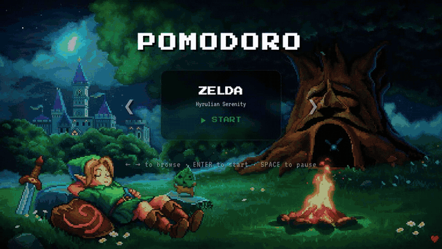

# Pomodoro Gaming

**A retro focus timer that drops you into the worlds of Zelda, Mario, Elden Ring, Pokémon and Minecraft.**

🔗 Live: [gaming-pomodoro.netlify.app](https://gaming-pomodoro.netlify.app/)

## Why I built it

I do long deep-work sessions, and generic Pomodoro timers never made me want to sit down and focus. What did work was the soundtracks of the games I love. So I built the timer I actually wanted to use: each session feels like stepping into a game world, with its own visuals, its own music and its own pacing.

## What it does

- **5 hand-crafted themes**: pixel-art video backgrounds and a curated soundtrack for each world (20 focus tracks + a dedicated break track per theme)
- **A full Pomodoro cycle**: 5-min "decompression" prep → 4 × (25 min focus / 5 min break)
- **Music that behaves like a game**: shuffled playlists with no repeats, a hand-picked opening track per theme, smooth crossfades between tracks and between focus/break phases
- **Seamless theme switching**: crossfading video backgrounds with instant poster frames, so no black screens
- **Reliable timing**: the countdown is based on the real clock, so it stays accurate even when the tab is in the background
- **Built for real focus sessions**: live countdown in the browser tab, keyboard shortcuts (← → to browse, Enter to start, Space to pause), volume and last theme remembered between visits
- Fullscreen mode, responsive down to mobile

## Design choices

- **Art direction first**: pixel fonts (*Press Start 2P*, *VT323*), retro UI sounds, and the background dims during breaks so the screen itself tells you which phase you're in.
- **Curation over quantity**: every playlist was selected track by track for calm, non-distracting focus, with a deliberate opening track for each world.
- **Zero friction**: no account, no settings to configure. Pick a world and press start.

## Tech

Vanilla HTML / CSS / JavaScript, no framework or build step. Deployed on Netlify.

Prototyped with Gemini in Cursor, then audited, debugged and polished with Claude.

## Disclaimer

This is a non-commercial, personal fan project made for my own study sessions. All music, videos, characters and trademarks belong to their respective owners (Nintendo, The Pokémon Company, FromSoftware, Mojang/Microsoft). No copyright infringement is intended; if you are a rights holder and want content removed, please open an issue and I'll take it down promptly.
